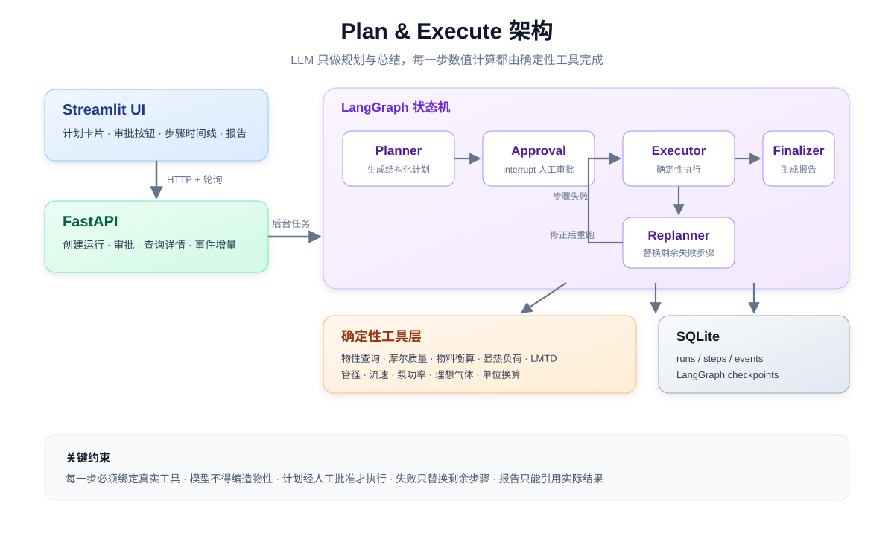

<p align="center">
  
</p>

<p align="center">
  <a href="https://github.com/Huhy666/chemical-process-calculation/actions/workflows/ci.yml">
    
  </a>
  
  
  
  
  
</p>

<p align="center">
  <b>LLM 制定计划 → 人工审批 → 确定性工具执行 → 失败自动重规划 → 可追溯报告</b>
</p>

<p align="center">
  <b>独立项目介绍页：<code>docs/index.html</code></b>
  ·
  <a href="https://github.com/Huhy666/chemical-process-calculation"><b>💻 源码</b></a>
</p>

一个可演示、可检查、可扩展的化工工艺计算 Agent Demo。

它刻意把“聪明”和“可靠”分开：**LLM 只负责规划与总结，所有数值计算都由本地确定性工具完成**。每一步计划都绑定真实工具，参数经 Pydantic 校验，结果落库可追溯。

---

## 为什么值得看

- **真正的人工审批**：基于 LangGraph `interrupt()` + SQLite checkpointer，计划生成后暂停，批准才执行；刷新页面或重启进程都能恢复。
- **不让模型算数**：执行器是纯确定性代码，模型无法“心算”出一个看似合理的错误答案。
- **步骤间数据可传递**：`${s1.density_kg_m3}` 自动解析前序结果，避免执行阶段再次调用 LLM 填参数。
- **失败可恢复**：步骤失败时只替换剩余步骤，已成功的结果保留；重规划有次数上限，防止死循环。
- **全过程可观测**：`runs / steps / events` 三张表 + 前端时间线，每次运行都能复盘。
- **LLM 可切换**：Mock（离线）、DeepSeek、Claude 共用同一套适配接口。

---


```


## 工作流程

```text
输入问题
   │
   ▼
① Planner 生成 1~8 步结构化计划
   │
   ▼
② 人工审批（批准 / 驳回并填写意见）
   │
   ▼
③ Executor 逐步调用确定性工具
   │
   ├── 成功 → 下一步
   └── 失败 → Replanner 替换剩余步骤（最多 2 次）
   │
   ▼
④ Finalizer 基于真实结果生成报告
```

## 架构

<p align="center">
  
</p>

```text
Streamlit UI  ──HTTP/轮询──▶  FastAPI  ──后台任务──▶  LangGraph
                                                       │
                              ┌────────────────────────┼──────────────────────┐
                              ▼                        ▼                      ▼
                         确定性工具层               SQLite                 LLM 适配层
                    物性·衡算·传热·流体         runs/steps/events      Mock/DeepSeek/Claude
```

---

## 快速开始

```bash
git clone git@github.com:Huhy666/chemical-process-calculation.git
cd chemical-process-calculation

# 1) 安装依赖
python -m venv .venv
.venv/Scripts/python.exe -m pip install -r requirements.txt

# 2) 一键启动（后端 8000 + 前端 8501，自动打开浏览器）
.venv/Scripts/python.exe run_demo.py
```

> Linux / macOS 请把 `.venv/Scripts/python.exe` 换成 `.venv/bin/python`。

打开 <http://127.0.0.1:8501>，从左侧选择示例问题即可体验。
后端 API 文档：<http://127.0.0.1:8000/docs>。

也可以分别启动：

```bash
# 后端
PYTHONPATH=backend .venv/Scripts/python.exe -m uvicorn app.main:app --host 127.0.0.1 --port 8000

# 前端（另开终端）
.venv/Scripts/python.exe -m streamlit run frontend/app.py --server.port 8501
```

默认 `LLM_PROVIDER=mock`，**无需 API Key**，可离线跑通 6 个内置示例。

---

## 配置 LLM

把 `.env.example` 复制为 `.env`：

```bash
cp .env.example .env
```

### DeepSeek

```dotenv
LLM_PROVIDER=deepseek
DEEPSEEK_API_KEY=sk-...
DEEPSEEK_BASE_URL=https://api.deepseek.com
DEEPSEEK_MODEL=deepseek-chat
```

### Claude

```dotenv
LLM_PROVIDER=claude
ANTHROPIC_API_KEY=sk-ant-...
ANTHROPIC_MODEL=claude-sonnet-5
# 使用中转网关时填写，留空走官方地址
ANTHROPIC_BASE_URL=
```

### 代理设置

```dotenv
# false：LLM 请求直连，忽略操作系统代理（默认）
# true ：走操作系统代理，适合需要代理访问 Anthropic 的网络环境
LLM_USE_SYSTEM_PROXY=false
```

Windows 上如果系统代理（如 `127.0.0.1:7890`）没有运行，Python 的 `requests/httpx` 会继承系统代理并报 `SSL: UNEXPECTED_EOF_WHILE_READING`。DeepSeek 国内可直连，保持 `false` 即可。

修改 `.env` 后重启后端。Mock 模式只识别内置示例；真实 LLM 可以理解任意化工计算问题。

---

## 内置示例

| 示例 | 涉及工具 |
|---|---|
| 水加热换热面积 | 物性查询、显热负荷、LMTD 换热面积 |
| 苯加氢物料衡算 | 反应进度、出口组成、产物物性 |
| 泵功率估算 | 物性查询、泵功率 |
| 理想气体体积流量 | PV=nRT |
| 管径流速校核 | 管径 / 流速 |
| 压力单位换算 | 单位换算 |

真实 LLM 示例（DeepSeek 实测）：

> 将 2.5 m³/h 的甲醇从 25°C 加热到 60°C，热源为 100°C 饱和蒸汽，总传热系数 K=600 W/(m²·K)，求所需换热面积。

Agent 自动规划 3 步：物性查询 → 显热负荷 48.70 kW → LMTD 55.68 K、面积 1.46 m²，并生成带步骤引用的报告。

---

## 化工工具集

| 工具 | 说明 |
|---|---|
| `get_substance_properties` | 25 种常用物质物性（摩尔质量、密度、比热、沸点、潜热） |
| `list_substances` | 列出物性库收录物质 |
| `molar_mass` | 化学式摩尔质量与元素组成 |
| `stoichiometry_calc` | 按计量系数、进料、限制反应物转化率计算出口组成 |
| `sensible_heat_duty` | 显热负荷 Q = ṁ·cp·ΔT |
| `heat_exchanger_area` | 逆流 LMTD 与换热面积 A = Q/(K·LMTD) |
| `pipe_diameter` | 按目标流速估算管径并推荐标准 DN |
| `pipe_velocity` | 已知流量与管径计算流速 |
| `pump_power` | 水力功率、轴功率与电机功率 |
| `ideal_gas` | PV=nRT 求解任意一个缺失参数 |
| `unit_convert` | 压力、流量、质量、功率、能量、长度、体积、温度换算 |

所有工具都是纯函数：不访问网络、不调用 LLM、不读写数据库。

---

## 目录结构

```text
backend/app/
  agent/        LangGraph 图、planner/executor/replanner/finalizer、引用解析
  api/          FastAPI 路由
  db/           SQLite 建表与仓储
  llm/          Mock / DeepSeek / Claude 适配层
  tools/        化工计算工具与物性数据
  schemas/      Pydantic 计划与请求模型
frontend/
  app.py        Streamlit 页面
  api_client.py 后端调用封装
  components/   计划卡片、步骤时间线、事件流
backend/tests/  27 个测试（工具、引用、状态机、API）
assets/         仓库横幅与架构图
docs/design.md  设计说明
```

---

## API

| 方法 | 路径 | 说明 |
|---|---|---|
| `POST` | `/api/runs` | 创建运行并后台生成计划 |
| `POST` | `/api/runs/{id}/approve` | `{"action":"approve"}` 或 `{"action":"reject","feedback":"..."}` |
| `GET` | `/api/runs/{id}?after_event_id=N` | 运行状态、步骤、增量事件（UI 轮询） |
| `GET` | `/api/runs?limit=20` | 历史运行 |
| `GET` | `/api/tools` | 工具目录与参数 Schema |
| `GET` | `/api/examples` | 内置示例问题 |
| `GET` | `/api/health` | 健康检查与当前 LLM |

---

## 测试

```bash
.venv/Scripts/python.exe -m pytest
```

当前 **27 passed**，覆盖：

- 全部化工工具的正常与异常输入
- `${step.path}` 引用解析
- 完整状态机：规划 → 审批中断 → 执行 → 报告
- 驳回重规划
- 步骤失败 → 重规划放弃 → `FAILED`
- FastAPI 创建、审批、幂等冲突、404

CI 配置见 [`.github/workflows/ci.yml`](.github/workflows/ci.yml)。

---

## 设计取舍

- **为什么用 LangGraph**：`interrupt()` + checkpointer 提供了成熟的人工审批暂停/恢复能力，避免自研状态持久化。设计细节见 [`docs/design.md`](docs/design.md)。
- **为什么执行器不用 LLM**：数值计算交给确定性工具，模型只做规划和总结，结果可复现、可测试。
- **为什么用轮询而不是 SSE**：Streamlit 对 SSE 支持不友好，轮询 + `after_event_id` 增量拉取更稳定，也方便从数据库恢复页面。

## 已知限制

- 物性为常用物质的简化常数（25°C / 1 atm 附近），未覆盖非理想体系、温度依赖、污垢热阻、压降与设备选型校核。
- 计划为线性步骤，暂不支持并行分支与 DAG 依赖。
- LangGraph 调用加进程内锁，SQLite checkpointer 适合单机演示，不适合高并发生产。
- 无登录、权限与多租户隔离，仅用于本地 Demo。
- Mock 模式只是离线演示与测试替身，不具备通用问题理解能力。

---

## License

[MIT](LICENSE) © 2026 Huhy666
